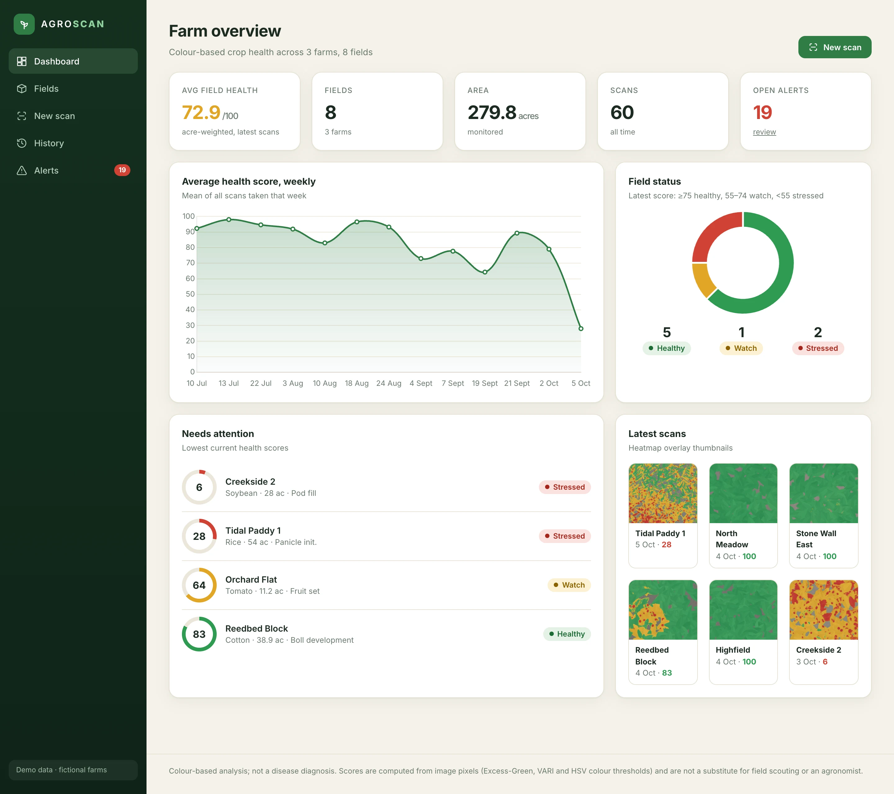
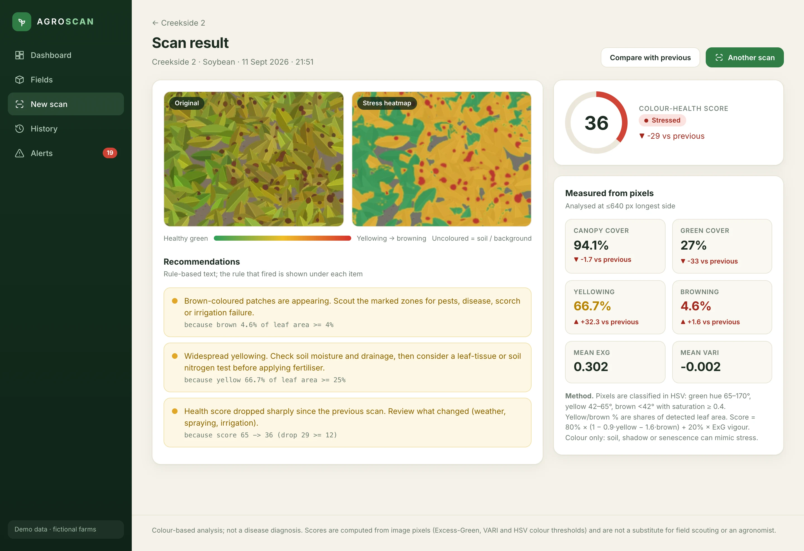
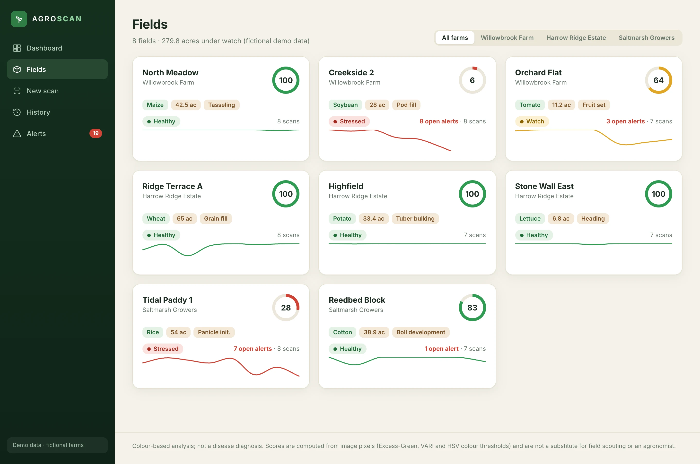
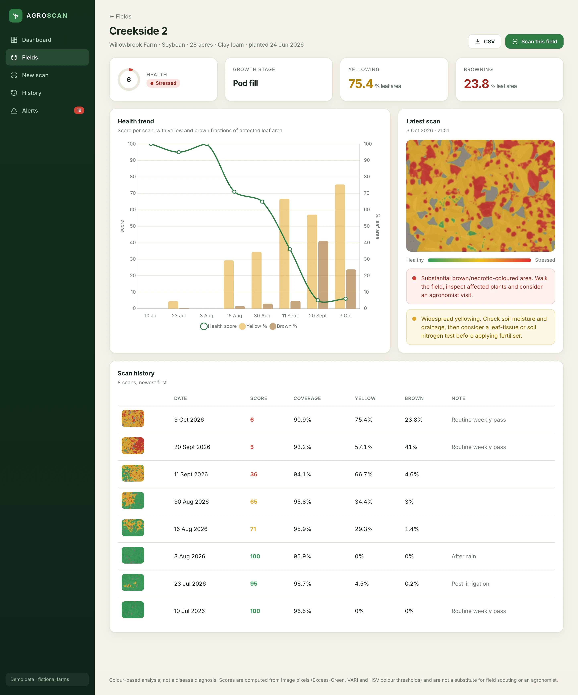
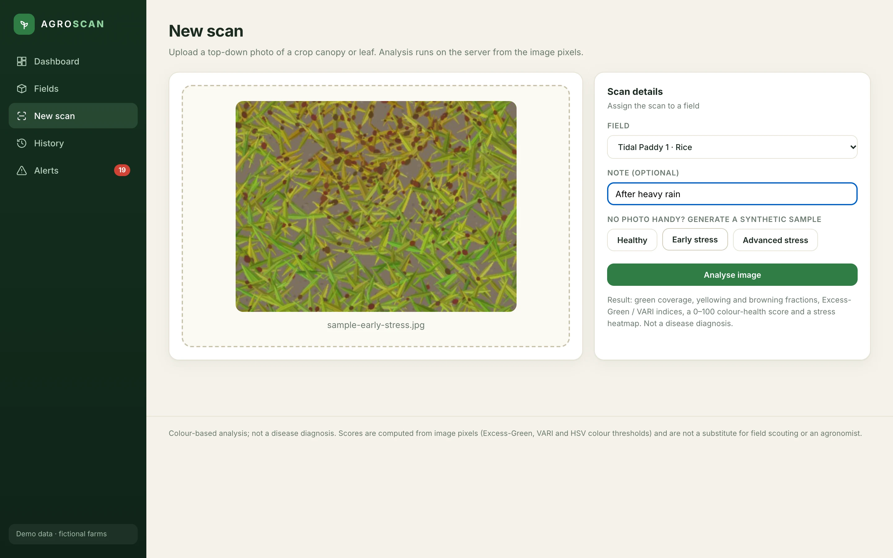
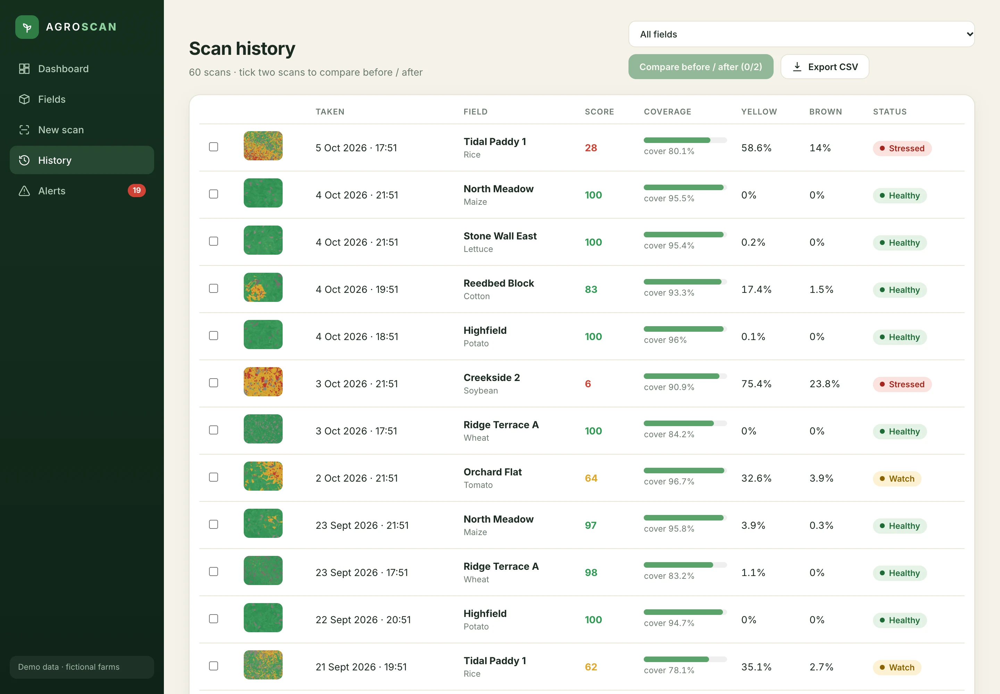
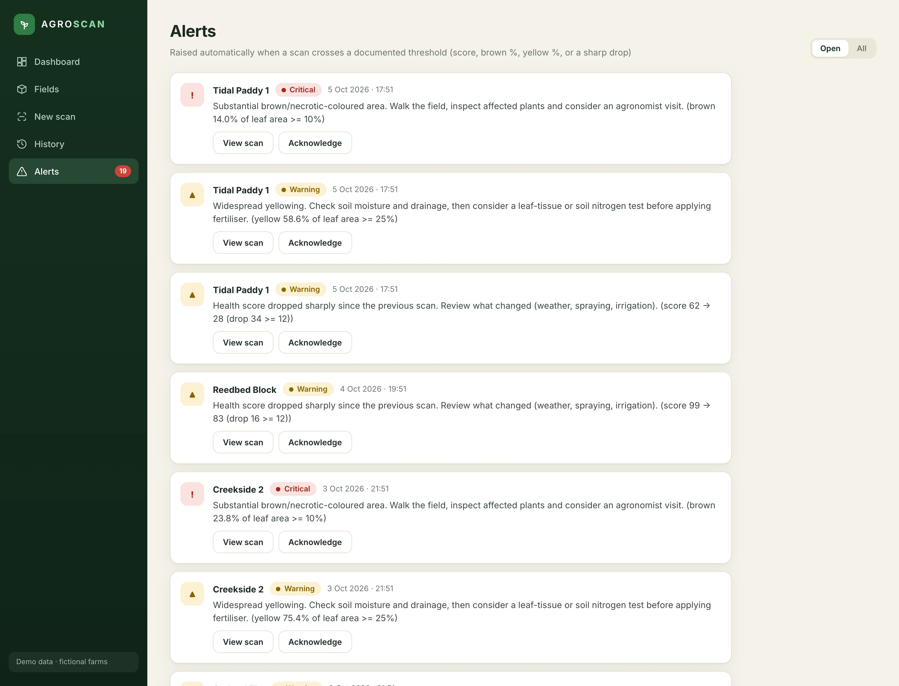
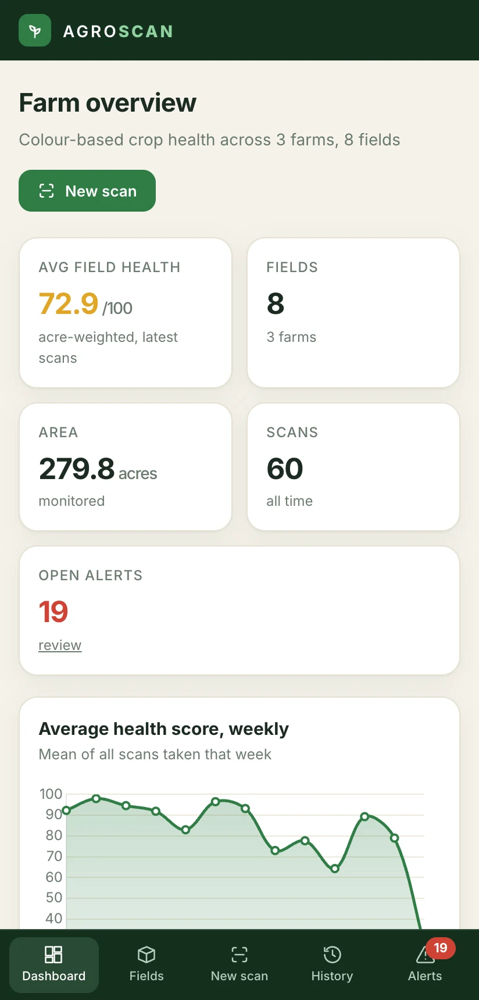

# AGRO-SCAN

**Crop-health scanning with real pixel analysis: upload a canopy photo, get a colour-health score, a stress heatmap and rule-based next steps.**

**Web app** 
FastAPI · SQLite · Pillow · NumPy · Vanilla JS · Chart.js

<table>
  <tr>
    <td></td>
    <td></td>
  </tr>
</table>
Screenshots are real captures of a local build running on fictional demo data.

---

## Product at a Glance

| | |
|---|---|
| **What it is** | Reference implementation of a crop-scanning app with colour-based analysis |
| **Analysis** | HSV colour classification, Excess-Green and VARI, canopy cover, yellowing and browning shares |
| **Output** | 0-100 colour-health score, stress heatmap, rule-based recommendations, alerts |
| **Data** | Seeded fictional data: 3 farms, 8 fields, 60 scans from synthetic Pillow-drawn images |
| **Stack** | FastAPI, SQLite, Pillow, NumPy, vanilla JS, Chart.js |

## Product Showcase

<table>
  <tr>
    <td> Fields with health rings, status and sparklines</td>
    <td> Field detail: score trend with yellow and brown fractions</td>
  </tr>
  <tr>
    <td> Upload flow with a synthetic sample selected</td>
    <td> Scan history with before/after compare and CSV export</td>
  </tr>
  <tr>
    <td> Alerts, each with the measured value that fired it</td>
    <td> Mobile layout</td>
  </tr>
</table>

## Key Features

- Farms and fields with crop, acreage, growth stage and latest health score
- Image upload with real pixel analysis: green cover, yellowing and browning, ExG and VARI
- Stress heatmap overlay beside the original image
- Per-field health trend charts, scan history and two-scan compare
- Alerts and recommendations from transparent threshold rules
- CSV export
- Built-in synthetic sample generator for trying the flow without a camera
- Responsive layout with phone navigation

## Architecture

One FastAPI service serves a REST API and a static single-page frontend. An analysis module (Pillow and NumPy) turns each image into metrics, a score and a heatmap; SQLite stores records and images live on disk. The seed script generates synthetic images and sends them through the same pipeline as uploads. See [docs/ARCHITECTURE.md](docs/ARCHITECTURE.md).

## Engineering Highlights

- Every number is computed from pixels with documented thresholds; the method is printed on each result
- Yellow and brown are shares of detected leaf area, and near-empty frames are rejected rather than scored
- Recommendations store the measured value that triggered them
- Seeded demo data goes through the real pipeline, so charts and alerts are genuine outputs
- Heatmaps are smoothed and blended for readability

## Status & Scope

This is a **reference implementation** with **colour-based analysis**. It has **no machine-learning model and no disease classifier**, and it is not a disease diagnosis; the footer says so on every page. Scores, heatmaps, recommendations and alerts are real computed outputs from rule-based logic. Thresholds were tuned on synthetic imagery and are not validated on real field photos. The demo build runs on seeded fictional data and has no authentication.

The original project folder this was named after contained only empty placeholder files; this app is a new build.

## Documentation

- [Product overview](docs/PRODUCT_OVERVIEW.md)
- [Architecture](docs/ARCHITECTURE.md)
- [Technical case study](docs/TECHNICAL_CASE_STUDY.md)
- [Engineering challenges](docs/ENGINEERING_CHALLENGES.md)
- [Privacy and source](docs/PRIVACY_AND_SOURCE.md)

Rights and usage: [RIGHTS.md](RIGHTS.md)
