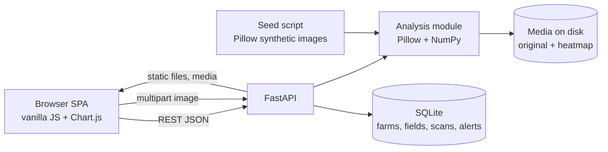

# Architecture

A small, single-process app: one FastAPI service, one SQLite file, one static single-page frontend.

## Components
- **Frontend.** One HTML page, a hash router and Chart.js (vendored). Pages: dashboard, fields, field detail, scan result, upload, history, compare, alerts. Responsive layout with a bottom nav on phones.
- **API.** Endpoints for farms, fields, field detail, summary, scans (list, detail, upload), a synthetic sample generator, alerts (list, acknowledge) and CSV export.
- **Analysis module.** Downscales to 640 px, converts to HSV, classifies green, yellow and brown pixels with fixed thresholds, computes Excess-Green and VARI over leaf pixels, derives the score, renders the heatmap and evaluates recommendation rules.
- **Storage.** SQLite for records (recommendations stored as JSON per scan); images saved as files.
- **Seeding.** On first start, fictional farms and fields are created and 60 synthetic images are generated, then saved through the same code path as uploads, so scores, heatmaps, recommendations and alerts are all genuinely computed.

## Request flow for a scan
1. Upload image, field and note.
2. Analysis returns metrics, masks and the resized image.
3. Heatmap is rendered; both images are saved.
4. The previous valid scan for the field is fetched so the rules can check for a sharp score drop.
5. Scan row and any warning or critical alerts are inserted; the client navigates to the result page.

## Design choices
- Every number is explainable from pixels and a stated threshold; the UI prints the method and thresholds.
- Frames with under 2% vegetation are marked invalid rather than scored.
